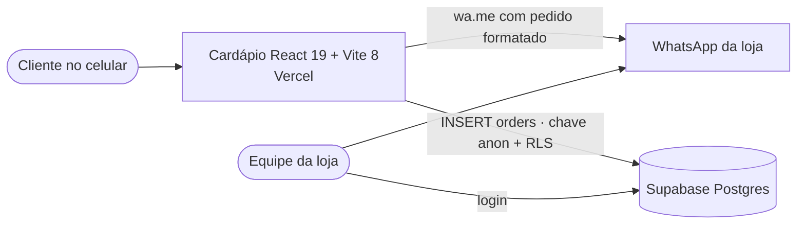

# Arquitetura — Garagem Lanches (catalogo-acai)

> Atualizada em 30/10/2026. O site está na Vercel, sem Supabase configurado no build publicado.

## 1. Visão C4



| Contêiner | Tecnologia | Responsabilidade |
|---|---|---|
| SPA | React 19, TypeScript 6, Tailwind 4, Vite 8 | Cardápio, montagem, carrinho, checkout |
| Canal | WhatsApp (`wa.me`) | Confirmação humana do pedido (canal principal) |
| BaaS | Supabase (Postgres + RLS) | Histórico de pedidos; leitura só autenticada |

## 2. Estrutura (Feature-Sliced Design, mantida e completada)

```
src/
├── pages/cardapio/CardapioPage.tsx      composição da tela
├── features/order/
│   ├── model/order.ts                   (novo) preço do açaí, validação, mensagem e link do WhatsApp
│   └── ui/AcaiBuilderModal.tsx          montagem com preço discriminado
├── entities/
│   ├── menu/model/menu.data.ts          catálogo
│   └── cart/model/cart.ts               (novo) reducer puro do carrinho
├── shared/
│   ├── api/supabase.ts                  cliente opcional por variável de ambiente
│   ├── config/store.ts                  (novo) regras comerciais (inclusos, adicionais, whey, WhatsApp)
│   ├── lib/money.ts                     (novo) centavos e formato pt-BR
│   └── ui/Dialog.tsx                    (novo) modal acessível
└── test/setup.ts                        Vitest + jest-dom
documentacao/                            análise, arquitetura, plano e SQL do Supabase
docs/                                    saída do build; o GitHub Pages está desligado
```

Regra de dependência do FSD: `pages → features → entities → shared`, nunca o contrário.

## 3. Modelo de dados

### 3.1 Estado no cliente

| Estrutura | Campos | Observação |
|---|---|---|
| `CartLine` | `key`, `name`, `unitCents`, `details`, `quantity` | `key = nome + detalhes + preço`: dois copos iguais somam; montagens diferentes ficam separadas |
| `CheckoutForm` | `name`, `phone`, `deliveryType`, `address` | Validado antes de abrir o WhatsApp |

### 3.2 Tabela `orders` (Supabase)

| Coluna | Tipo | Regra |
|---|---|---|
| `id` | bigint identity | PK |
| `created_at` | timestamptz | default `now()` |
| `customer_name` | text | 3–120 caracteres |
| `customer_phone` | text | só dígitos, 10–13 |
| `delivery_type` | text | `delivery` ou `retirada` |
| `address` | text | 3–300 caracteres |
| `items` | jsonb | array com 1–50 itens `{ name, details, quantity, unit_cents }` |
| `total_amount` | numeric(10,2) | > 0 e < 2000 |

`items` em JSONB é uma escolha consciente de **snapshot** do pedido (preço e descrição no momento da compra), e não uma violação de normalização: o cardápio pode mudar sem alterar pedidos antigos. Script: [supabase-orders.sql](./supabase-orders.sql).

## 4. Decisões de arquitetura (ADR)

### ADR-001 — Dinheiro em centavos inteiros

- **Decisão:** `toCents` na entrada, soma em inteiros e `Intl.NumberFormat('pt-BR')` na saída.
- **Consequência:** fim do erro de arredondamento e do "R$ 17.90".

### ADR-002 — WhatsApp primeiro, banco depois

- **Decisão:** abrir o WhatsApp de forma síncrona no clique e gravar no Supabase em segundo plano.
- **Consequência:** o navegador não bloqueia o pop-up; se o Supabase falhar, o pedido ainda chega à loja. A tela de sucesso diz "pronto para envio", porque o envio real acontece no WhatsApp.

### ADR-003 — Supabase por variável de ambiente e RLS só-inserção

- **Contexto:** a chave `publishable`/`anon` vai para o navegador de qualquer forma; a segurança está na RLS.
- **Decisão:** `VITE_SUPABASE_URL` e `VITE_SUPABASE_ANON_KEY` no `.env`; política `INSERT` para `anon` e `SELECT` só para `authenticated`.
- **Consequência:** sem `.env`, o app funciona só com WhatsApp. O total enviado pelo cliente não é confiável para cobrança; a loja confere no WhatsApp (validação de preço no servidor fica para uma função do Postgres no futuro).

### ADR-004 — Documentação em `documentacao/`

- **Decisão:** manter `docs/` como saída do build para o GitHub Pages (configuração atual do repositório) e usar `documentacao/` para os documentos.
- **Consequência:** nada muda no deploy; os documentos não são apagados pelo build nem publicados no site.

### ADR-005 — Adicionais visíveis

- **Decisão:** a regra de R$ 2,00 por acompanhamento a partir do 4º foi mantida, mas agora aparece no subtítulo do modal e no valor final.
- **Consequência:** preço transparente. **Confirme o valor com a loja** (o código original marcava como "exemplo").

### ADR-006 — Publicar na Vercel

- **Contexto:** o endereço do repositório aponta para a Vercel, e o GitHub Pages responde 404.
- **Decisão:** registrar a Vercel como hospedagem atual. A configuração dela não está no repositório.
- **Consequência:** `docs/` deixou de ter função clara e deve sair depois de conferir o painel da Vercel.

## 5. Fora do escopo

- Painel da loja para ver pedidos, status do pedido e pagamento online.
- Cardápio vindo do Supabase (hoje está no código).
- Horário de funcionamento real (o selo "Aberto" fixo foi removido).
